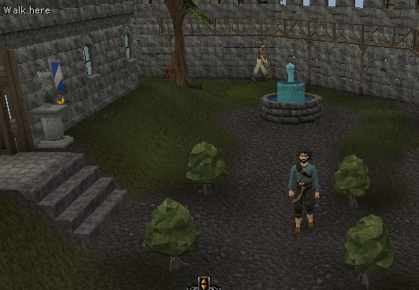
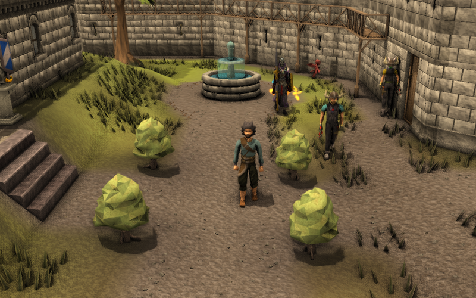

## HD graphics

Previous releases always ran in the 2012 client's safe mode, the lowest-quality
software renderer. This release starts in HD mode with every setting raised:

- OpenGL HD renderer with per-pixel lighting, bloom, 4x anti-aliasing, HD water,
  and the highest render distance
- Textures drawn at 512 pixels instead of 128. The 2012 materials are
  procedural, so this adds real detail (stone edges, wood grain, grass
  blades) instead of blur. `-Ddarkan.textureSize=128` restores the original.
- New post-processing pass: FXAA, sharpening, a richer colour grade, and a
  light vignette
- Resizable mode now fills the whole window on large monitors; the 2012
  client stopped at 1024x768 unless you changed the maximum screen size
- View distance pushed out by about 50%, so the fog no longer cuts off the
  highest render distance

| Classic (v0.16.1) | HD (v0.17.0) |
| --- | --- |
|  |  |

These are improvements to the 2012 engine, not a remaster. Models and
textures are still the 2012 ones.

To make HD work on current systems, the client now patches the 2012 Linux
OpenGL library so it loads on modern Java, accepts Mesa (the standard AMD and
Intel driver on Linux), and fixes two shader problems strict drivers reject.

If HD cannot start, the game falls back to safe mode automatically and the
launcher window says why. A launch that crashes while starting the renderer
comes back in safe mode, and holding **S** while loading forces it. Everything
can be changed in the in-game Graphics Settings menu; turning off Bloom also
turns off the post-processing. The README's
[Graphics section](https://github.com/kennethyork/single-rs-2012#graphics)
lists advanced options and explains how to add ReShade on Windows.

## Upgrading

Existing Linux installs keep their saved graphics settings. Delete
`cache/preferences.dat` once, or pick HD in the Graphics Settings menu, to get
the new defaults. Windows and macOS pick up the new defaults automatically.

## Platform notes

HD was tested in game on Linux. It uses the same OpenGL library on Windows. On
macOS, the 2012 OpenGL library may not load on current Java, in which case the
game falls back to safe mode as before.

Each download is self-contained. Only `client.jar`, the READMEs, and (on Linux)
the default graphics settings changed since v0.16.1; the world server, cache,
and Java 24 runtime are unchanged. The archives contain an empty `saves/`
directory and no personal data. Extract the entire archive before launching.
